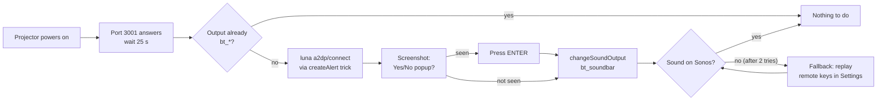

# LG CineBeam Q → Sonos Arc Ultra, reconnected automatically

[](https://github.com/amartidandqdq/lg-cinebeam-sonos/actions/workflows/gitleaks.yml)


[](https://github.com/amartidandqdq/lg-cinebeam-sonos/actions/workflows/ci.yml)


Turn the projector on. About 40 seconds later, the sound plays on the Sonos.
No root, no developer mode, no remote in hand, no "Yes" to click.

> **The problem.** The LG CineBeam Q (HU710QKE, webOS 24) forgets its Bluetooth soundbar on every
> cold boot. Getting it back takes six clicks in the menus plus a confirmation popup, every time.
>
> **The fix.** A ~250-line Python watcher on any always-on Linux box on the LAN. It notices the
> projector powering on and reconnects the Sonos through the projector's own local API (SSAP).

## How it works



| Step | What happens | SSAP call |
|------|--------------|-----------|
| Detect | TCP probe on the projector every 15 s | none |
| Check | Read the current sound output | `ssap://audio/getStatus` |
| Connect | Open the A2DP link to the Sonos | `luna://com.webos.service.bluetooth2/a2dp/connect` |
| Accept | Find the "wants to connect" popup on a screenshot, press ENTER | `ssap://tv/executeOneShot` + pointer input socket |
| Route | Send the audio to the soundbar | `ssap://com.webos.service.apiadapter/audio/changeSoundOutput` |
| Fallback | Settings → Sound → Sound Out → Wireless Speaker → Sonos → Connect | `system.launcher/launch` + remote keys |

It runs **once per power-on**. If you switch the output by hand afterwards, the watcher leaves it alone.

### Safety rules

- A **short LAN drop is not a power-off**: the projector is declared off only after 4 failed probes in a row.
- If BT was active before a missed probe and is lost when the projector returns, reconnect with `luna` only. This also covers power cycles shorter than the power-off threshold; an unchanged output does not trigger a reconnect.
- **Remote keys are replayed once at most**, on the first round after a real power-on. Never on a retry, and never when the service restarts on a projector that is already on.
- After a failed round: up to 3 retries (2, 10, 30 min), invisible `luna` only. Then it gives up until the next power-on.
- Retries stop when another output such as HDMI/ARC is observed. Selecting `tv_speaker` by hand is indistinguishable from the projector's default after a failed BT connection, so that choice cannot cancel retries reliably.
- `SORTIE BT ACTIVE` means the projector *reports* `bt_*`. It cannot prove the audio is heard on the Sonos.

## Quick start

**You need:** the projector and a Linux box on the same LAN, Python 3.11+, and the Sonos already
paired once over Bluetooth from the projector menu.

1. **Install**

   ```sh
   git clone https://github.com/amartidandqdq/lg-cinebeam-sonos && cd lg-cinebeam-sonos
   python3 -m venv ~/.venvs/sonos-watcher
   ~/.venvs/sonos-watcher/bin/pip install -r requirements.txt
   mkdir -p ~/sonos-watcher && cp watcher/sonos-watcher.py ~/sonos-watcher/
   ```

2. **Pair with the projector (once).** With the projector on, run the command below and accept the
   prompt on screen within 60 s. The key lands in `~/sonos-watcher/client-key.txt`.

   ```sh
   ~/.venvs/sonos-watcher/bin/python tools/pair.py 192.168.1.2
   ```

3. **Configure.** Create `~/sonos-watcher/watcher.env` from `watcher/watcher.env.example`:

   | Variable | Set it to | Default |
   |----------|-----------|---------|
   | `LG_HOST` | Projector LAN IP (reserve it in your router) | `192.168.1.2` |
   | `SONOS_BT` | Sonos Bluetooth address (same as its Wi-Fi MAC on the Arc Ultra). **Required**: the service refuses to start without it | none |
   | `MENU_KEYS` | Comma-separated key path of the fallback, if your menu differs | webOS 24 path |
   | `WARMUP` | Seconds to wait after power-on | `25` |

   `TARGET` (`bt_soundbar`) and the retry timings are constants at the top of the script.

4. **Run as a user service**

   ```sh
   mkdir -p ~/.config/systemd/user
   cp watcher/sonos-watcher.service ~/.config/systemd/user/
   systemctl --user daemon-reload
   systemctl --user enable --now sonos-watcher
   loginctl enable-linger "$USER"   # keep it running after logout
   ```

5. **Check.** Power-cycle the projector, then:

   ```sh
   tail -f ~/sonos-watcher/watcher.log
   ```

   ```text
   projecteur detecte — warmup 25 s...
   sortie actuelle tv_speaker -> connexion Sonos...
     popup de connexion detecte -> Yes
     tentative 1/2 (luna): SORTIE BT ACTIVE
   ```

   Log lines are in French. Uninstall with `systemctl --user disable --now sonos-watcher`.

## The luna trick

SSAP clients cannot call `luna://` services directly. webOS will, however, run the URI attached to a
system alert's `onclose` when that alert is closed. So the watcher:

1. creates an alert whose `onclose`, `onfail` and button all point to the luna call;
2. closes it straight away with `closeAlert`.

The call runs blind (no response comes back), so the watcher checks the result through
`audio/getStatus`. Credit for the technique:
[brunofgmag/lgtv-control-mcp](https://github.com/brunofgmag/lgtv-control-mcp).

## Troubleshooting

| Symptom | Likely cause | Fix |
|---------|--------------|-----|
| Output says `bt_soundbar` but sound stays on the projector | The Yes/No popup was not accepted | Check the `POPUP` pixel signature against a fresh capture (`tools/popup.py`) |
| `echec definitif` | Sonos off, asleep or out of range | Wake the Sonos; it retries at the next power-on |
| Fallback opens the wrong menu | Menu order differs, or the Sonos is not the first registered device | Adjust `MENU_KEYS` in `watcher.env` while watching `tools/nav.py` screenshots |
| `WS indisponible` in a loop | Wrong `HOST` or a revoked `client-key` | Fix the IP, pair again |
| Sound drops when you start Sonos radio | Sonos leaves BT for the new source | Expected; the watcher only acts once per power-on |

## Repository layout

| Path | Contents |
|------|----------|
| `watcher/` | The service and its systemd unit |
| `tools/` | `pair.py` (one-time pairing), plus debug helpers: `nav.py` (keys and screenshots), `luna.py` (raw luna call), `a2dp.py` (connect test), `popup.py` (popup detection), `sonosctl.py` (Sonos UPnP state) |
| `tests/` | `pytest` suite: power-off hysteresis, bounded retries, a simulated `main()` loop, `/etc/hosts` rollback |
| `scripts/`, `PLAN.md`, `trouvailles.md` | The original debloat plan (separate, experimental, reversible with `restore-root.sh`) and the full investigation log (French; §10–12 cover the reconnect) |
| `legacy/` | Superseded experiments. Do not use |
| `backup/` | Read-only snapshot of the projector's app inventory |

## Limitations

- Tested on one setup: HU710QKE, webOS 24, Sonos Arc Ultra.
- A firmware update may move the popup or reorder the menus. Both are one constant to update.
- The `client-key` grants control of the projector. It is git-ignored (and written `0600`); keep it that
  way. MACs and Sonos IDs in this repo are placeholders.
- TLS certificate checks are off: the projector presents a self-signed certificate. Keep port 3001 on
  your LAN only.
- The pairing manifest asks for broad SSAP permissions (copied from the key that is known to work).
  Narrowing them is untested.

## Development

```sh
pip install -r requirements.txt -r requirements-dev.txt
ruff check . && python -m pytest -q
```

Version history: [CHANGELOG.md](CHANGELOG.md). Licensed under [MIT](LICENSE).

## Thanks

- [brunofgmag/lgtv-control-mcp](https://github.com/brunofgmag/lgtv-control-mcp) for the `createAlert`
  → `luna://` technique. Without it, this would still be a remote-key macro.
- The webOS homebrew and SSAP community, whose reverse-engineering notes made the local API usable.
- [websockets](https://github.com/python-websockets/websockets) and
  [Pillow](https://github.com/python-pillow/Pillow), the only two dependencies.

## Disclaimer

Personal project, not affiliated with LG Electronics or Sonos. It uses the projector's local
API only; nothing leaves your LAN.
