# Watcher state machines

The watcher has one real lifecycle — the **recovery phase** of the current power-on — plus a few
small local machines. Up to 0.3.2 the recovery phase was implicit, spread over ten booleans and
counters in `main()` (`handled`, `adopted`, `observed`, `had_miss`, `last_bt`, `failed_rounds`,
`next_try`, `drop_reads`, `drops`, `ws_down`). Since 0.3.3 it is the explicit `Phase` enum and
the `Recovery` class in `watcher/sonos-watcher.py`. Behavior is unchanged: the previous suite
passes untouched, and a differential run of the old and new loops on 3000 randomized simulated
scenarios produced identical connect calls, timings and logs.

## Recovery phase (`Phase`, `Recovery`)

`main()` does the I/O (probe, session, output read, connect round, sleeps); `Recovery` makes the
decisions and owns every transition. Each phase change logs one line:
`state=OLD->NEW reason=<slug>`. The current snapshot is written to `~/sonos-watcher/state.json`
whenever it changes, and `--diagnose` reports it under `watcher`.

```mermaid
stateDiagram-v2
    [*] --> STARTUP_OBSERVE: service_start
    STARTUP_OBSERVE --> WATCH: startup_observation (first reading, never acts)
    STARTUP_OBSERVE --> OFF: power_off
    OFF --> RECOVER: power_on (after WARMUP; menu allowed on round 1)
    RECOVER --> WATCH: bt_route_selected / bt_route_stable
    RECOVER --> WATCH: other_output_respected
    RECOVER --> RETRY_WAIT: round failed (15 s, 2, 10, 30 min)
    RECOVER --> WATCH: retries_exhausted
    RETRY_WAIT --> RECOVER: retry_N_due (Luna only)
    WATCH --> RECOVER: blip_lost_bt (AUTO_RECOVER_BLIPS=1, Luna only)
    WATCH --> RECOVER: bt_route_dropped (AUTO_RECOVER_DROPS=1, 2 reads, max 5 per power-on)
    WATCH --> OFF: power_off
    RECOVER --> OFF: power_off
    RETRY_WAIT --> OFF: power_off
```

| Phase | Meaning | Leaves on |
|---|---|---|
| `STARTUP_OBSERVE` | Service started on a running projector. The first output read is logged, never acted on. | first reading → `WATCH`; `power_off` |
| `OFF` | `OFF_AFTER` consecutive probes missed. Retry ladder and link-outage memory are reset. | `power_on` → `RECOVER` |
| `RECOVER` | The next output read decides: target route → `WATCH`, another output → `WATCH` (respected), `tv_speaker` → connect round. | connect round result; `power_off` |
| `RETRY_WAIT` | A round failed; nothing happens before `next_retry_at`. The output is re-read before acting. | delay elapsed → `RECOVER`; `power_off` |
| `WATCH` | Settled for this power-on (connected, other output respected, retries exhausted). Only an opt-in blip or drop recovery reopens it. | `blip_lost_bt`, `bt_route_dropped`, `power_off` |

Data carried across phases: `luna_only` (no menu keys; false only between a real power-on and
the next blip/drop recovery), `root_ok` (root transport available; places `root` first in the
method ladder), `failed_rounds`/`next_try` (retry ladder), `had_miss` (a probe missed since the
last read), `last_bt` (last read was the target route), `drop_reads`/`drops` (drop confirmation
and per-power-on cap), `link_down` (WebSocket outage logged once), `link`/`link_reads`/
`link_flag`/`link_episodes` (root link state, `bt_link_lost` confirmation and episode bookkeeping)
and `q1_captures` (per-power-on evidence-capture cap).
`reason=drop_cap_reached` in `WATCH` means the drop cap stopped recovery until the next power-on;
`reason=bt_link_lost` means a root-confirmed dead link with the route still on target, and
`reason=link_restored` its recovery.

Pause is orthogonal: the pause file stops the loop before any session; the phase is kept as is.

### Changing it

- Add or change a transition only in `Recovery`, through `_enter()`. Never set `phase` elsewhere.
- Keep `Recovery` free of I/O other than `log()`. `tests/test_recovery_state.py` drives it directly;
  `tests/test_main_loop.py` and `tests/test_drop_recovery.py` drive the whole loop with a fake clock.
- `state.json` is a status hint, not evidence: `pid_alive` only means a process with that PID
  exists, and `since` is the time of the last phase change, not a liveness heartbeat.

## Smaller state machines (left as local code)

These are short, linear and already explicit enough; extracting them would add code without
clarifying behavior.

| Where | States | Notes |
|---|---|---|
| `PowerTracker` | online ↔ offline, with a miss counter | Hysteresis: `off` after `OFF_AFTER` consecutive misses, `on` on the first success. Emits the events `Recovery` consumes. |
| `connect_round` | method ladder `root, luna[, luna][, menu]` (root only when the transport is up) → observe → stop/next | Ends on stable route, other output, timeout or a failed command (session never reused). `root_connect` = direct `a2dp/connect` → route re-read → `changeSoundOutput` over Luna root only if the route is not on target. |
| `observe_route` | 3 samples → `BT_ROUTE_STABLE` / `FAILED` / `UNKNOWN` | Evidence levels are in `RouteResult`. |
| `luna_connect` | alert → `confirm_popup` → verify → optional output write | Non-root path (and root fallback). Rechecks pause and output before every mutation. |
| `confirm_popup` | poll popup (≤ 8 × 2 s) → Yes or give up | Shared by the root and SSAP paths: the connect popup never dismisses by itself (user-reported 2026-11-09). Any output other than target/fallback aborts the confirmation. |
| `popup_state` | `YES_FOCUSED` / `ABSENT` / `UNKNOWN` | Returned enum; `UNKNOWN` never sends a key. |
| Pause file | active ↔ paused | Controlled by `--pause` / `--resume`, read on each loop and before each mutation. |

## Root link machine (root mode only, since 0.4.0)

When `ROOT_MODE` selects the root transport and the SSH probe succeeds, the loop also reads
the **real A2DP link** (`a2dp/getStatus`) on an adaptive cadence and feeds `Recovery.on_link()`:

- **Cadence:** hot (`LINK_POLL_HOT`, 30 s) for `LINK_HOT_WINDOW` (15 min) after any route or
  link transition, on WebSocket restore, and after the route settles; calm (`LINK_POLL_CALM`,
  300 s) when stable. The WebSocket-down branch keeps `LINK_POLL` (60 s). Link reads only run
  in `WATCH` with the target route.
- **States:** `connected` / `connecting` / `down` / `unavailable` (errorCode 106 — ambiguous:
  adapter reset, unpair or changed address; never triggers action, discriminated by
  `tools/q1_battery.py`) / `unknown`.
- **`down` confirmed twice** with the route on target → `reason=bt_link_lost` in `WATCH`
  (visibility and Q1 evidence capture; the recovery itself follows the route signal through
  `bt_route_dropped`, which is faster in a normal drop since the route falls back at once).
- **Capture cap:** one Q1 battery per episode, at most `Q1_MAX_CAPTURES` (5) per power-on,
  filed under `~/sonos-watcher/q1-captures/` with the MTK snoop HCI trace offloaded next to it.
- **Probe lifecycle:** re-probed at startup and at every power-on (plus a second chance after
  the warmup — sshd can be slow at boot); a failure degrades to the SSAP-only version and is
  retried at the next power-on, never fatally.
- **Snoop:** re-armed on every root gain (`/tmp` is tmpfs and is wiped at projector reboot);
  native 2 MB rotation, RAM-only.

`state.json` carries `link` (the last root link state) and `transport` (`root` or `ssap`) so
`--diagnose` always shows which version produced the information.
